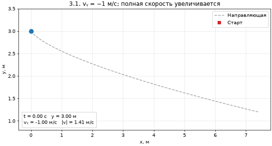
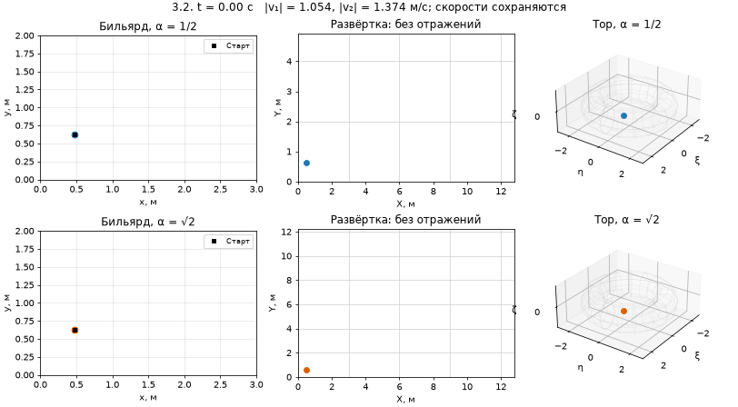
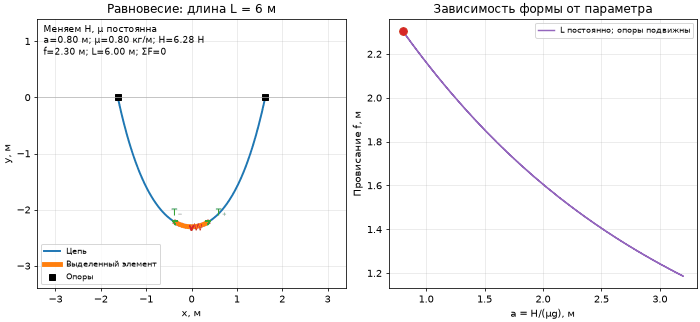
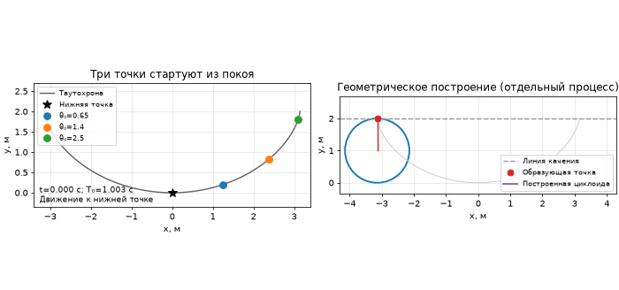
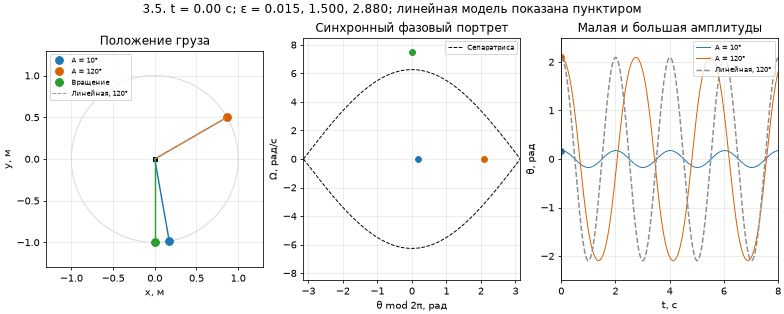

# Математика для программирования: КР № 3

Прикладные дифференциальные уравнения. Решения всех заданий 3.1–3.5 из листка № 3.

**[Открыть ноутбук с решениями](resheniya_listok_3_po_zadaniyam.ipynb)**

Оформление повторяет [листок № 1](https://github.com/inexcusableevil/mirea-math-programming-sheet-1/blob/main/resheniya_listok_1_po_zadaniyam.ipynb): каждый номер расположен в отдельном блоке, за заголовком следует самостоятельный код. В соответствии с требованиями листка № 3 перед кодом каждого задания добавлены подробный аналитический вывод в Markdown/LaTeX, а в коде — статический рисунок и анимация `FuncAnimation`.

| Номер | Задача | Статический рисунок | Анимация с управлением |
| --- | --- | --- | --- |
| 3.1 | Равномерный вертикальный спуск | [PNG](figures/3_1_descent.png) | [HTML](animations/3_1_descent.html) |
| 3.2 | Бильярд в прямоугольнике, развёртка и тор | [PNG](figures/3_2_billiard.png) | [HTML](animations/3_2_billiard.html) |
| 3.3 | Цепная линия и силы | [PNG](figures/3_3_catenary.png) | [HTML](animations/3_3_catenary.html) |
| 3.4 | Таутохрона и построение циклоиды | [PNG](figures/3_4_tautochrone.png) | [HTML](animations/3_4_tautochrone.html) |
| 3.5 | Математический маятник | [PNG](figures/3_5_pendulum.png) | [HTML](animations/3_5_pendulum.html) |

Ноутбук выполнен целиком; результаты расчётов и графики сохранены. GitHub не исполняет JavaScript в предпросмотре ноутбука. GIF-превью ниже доступны прямо на странице. Для паузы, воспроизведения и выбора кадра скачайте соответствующий HTML через **Download raw file** и откройте его в браузере. Изображения кадров включены в HTML; Python для такого просмотра не нужен. Также можно выполнить ноутбук в Jupyter и воспользоваться кнопками под ячейками.

Для повторного выполнения:

```bash
python -m pip install -r requirements.txt
jupyter notebook resheniya_listok_3_po_zadaniyam.ipynb
```

В меню Jupyter выберите **Run → Run All Cells**. Запускайте ноутбук из каталога репозитория. Каждый блок импортирует необходимые библиотеки; код отдельных заданий можно выполнять независимо. PNG, GIF и HTML создаются заново в папках `figures/` и `animations/`.

В решениях явно учтены условия моделей: в 3.1 постоянна вертикальная скорость; в 3.2 эргодичность рассматривается при фиксированном иррациональном направлении; в 3.3 при неизменной длине цепи положение опор меняется согласованно с её формой; в 3.4 точки стартуют из покоя; в 3.5 используется стержневой маятник, допускающий вращения.

## Анимации

### 3.1



### 3.2



### 3.3



### 3.4



### 3.5



## Документация библиотек

В точном решении маятника используется параметр эллиптических функций `m = sin(A/2)**2`: [SciPy — ellipk](https://docs.scipy.org/doc/scipy/reference/generated/scipy.special.ellipk.html), [SciPy — ellipj](https://docs.scipy.org/doc/scipy/reference/generated/scipy.special.ellipj.html).
